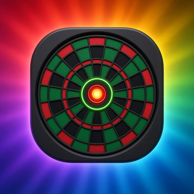

<p align="center">
  
</p>

<h1 align="center">Granboard for Home Assistant</h1>

<p align="center">
  <b>Turn your Granboard 3 into a fully connected smart dartboard.</b><br>
  Live hits over Bluetooth, games scored inside Home Assistant, board lighting, WLED effects, and custom sounds.
</p>

<p align="center">
  <a href="https://hacs.xyz"></a>
  <a href="https://github.com/afcragg78/ha-granboard/releases"></a>
  
</p>

---

Home Assistant custom integration for the **Granboard 3** Bluetooth dartboard. It connects through Home Assistant's Bluetooth integration (a USB adapter or an ESPHome Bluetooth proxy), turns every dart into an event, and runs the game (x01, Cricket, Count-Up, Around The Clock) inside Home Assistant, so a dashboard only has to display it.

## Features

- **Live Hits** – every dart becomes a Home Assistant event and sensor update, with segment, score, and ring.
- **Games Built In** – x01 (with double out), Cricket, Count-Up, and Around The Clock, with undo, next player, and clear game.
- **Player Colors** – each player gets a sharp, fully saturated color on the board and on your lights.
- **Board Lighting** – hit flashes, award effects (Bullseye, Ton 80, Hat Trick and more), and the circular wipe between turns, like the official app.
- **LED Ring Light** – use the board's ring as a light between games, with 15 effects and 64 WLED-style palettes.
- **WLED And Lights** – fire automations from hits, turns, and awards to light up the room.
- **Custom Sounds** – pick your own MP3 for each hit, award, and game event in Configure.
- **App Kill Switch** – release the board with one tap so the official Granboard app can connect.

**This project is unofficial and is not affiliated with, endorsed by, or supported by Granboard / GRAN Darts.** The Bluetooth protocol is community reverse-engineered.

## Install (HACS custom repository)

1. In HACS, open the menu (⋮) → **Custom repositories**.
2. Add `https://github.com/afcragg78/ha-granboard` with type **Integration**.
3. Find **Granboard** in HACS, download it, and restart Home Assistant.
4. Turn the board on (the light flashes red while it waits for a connection) and **close the Granboard phone app** — the board takes one connection at a time.
5. Home Assistant discovers the board (name `GRANBOARD`, service `442f1570-…`). Add it, or use **Add Integration → Granboard** and pick or type its Bluetooth address.

If the connection drops, move an ESPHome Bluetooth proxy close to the board.

## Using the phone app instead

**Granboard Connection** is a kill switch. Turn it off (or press **Release Board**) and Home Assistant disconnects at once and makes no connection attempts until you turn it back on, so the official app can connect. The setting is saved and survives Home Assistant restarts.

## Entities

| Entity | What it shows |
|---|---|
| Switch **Granboard Connection** | Kill switch. Off releases the board and stays released. |
| Button **Release Board** | Turns the switch off. |
| Binary sensor **Connected** | The Bluetooth link is up. |
| Sensor **Last Hit** | Segment (`T20`, `D16`, `S5`, `SB`, `DB`, `MISS`), with number, multiplier, score, ring, and raw frame as attributes. |
| Sensor **Last Raw Frame** | The last frame exactly as received (diagnostic). |
| Sensor **Signal Strength** | RSSI from the last advertisement (diagnostic). The board stops advertising while connected, so this updates only while it is not. |
| Light **LED Ring** | The board's LED ring as a light between games (see LED Ring Light below). |
| Select **Ring Palette**, Numbers **Ring Speed** / **Ring Intensity**, Text **Ring Color 2** | LED Ring effect settings (configuration). |
| Sensor **Game** | `idle`, `playing`, or `finished`. The attributes are the whole game (below). They are excluded from the recorder. |

## Events

- `granboard_hit`: `segment`, `number`, `multiplier`, `score`, `ring` (`treble`, `double`, `single_inner`, `single_outer`, `bull`, `bullseye`, `miss`, or `unknown`), `raw`, `address`, `entry_id`. An unknown frame fires with `segment: unknown` and is logged as a warning, so it can be added to the map.
- `granboard_button`: the board button (`raw: BTN@`). During a game it also ends the turn (can be turned off in the integration's options).
- `granboard_award`: `type` is one of `bullseye` (any bull; check `segment` for `SB` / `DB`), `ton` (100–139), `ton_40` (140–150), `high_ton` (151–179), `ton_80` (180), `hat_trick` (three bulls), `three_in_a_bed` (three darts in the same bed), `white_horse` (three different trebles on Cricket numbers), `bust`, `winner`. Also `player`, `player_index`, and `score` / `segment` where they apply. Ton awards count in x01 and Count-Up only.

Use these to drive WLED or anything else from an automation.

## Services

| Service | Fields |
|---|---|
| `granboard.new_game` | `game`: `x01`, `cricket`, `count_up`, `around_the_clock`; `start`: 301 / 501 / 701; `double_out`; `rounds` (Count-Up defaults to 8; 0 = no limit); `players`: list of names. |
| `granboard.undo` | Takes back the last dart or turn change. Can be repeated. |
| `granboard.next_player` | Ends the turn, even with darts left. |
| `granboard.end_game` | Stops the game. |
| `granboard.throw` | `segment` such as `T20`, `D16`, `SB`, `DB`, `MISS`. Scores a dart without the board, for testing a dashboard. |

All take an optional `device_id` when you have more than one board.

### Rules

- A turn is three darts. After the third dart, a bust, or a win, further darts are ignored until the next player (board button or `next_player`).
- **x01**: a bust (below zero, or with Double Out finishing on a non-double or leaving 1) puts the score back to the start of the turn. The bullseye counts as a double. A checkout suggestion is shown for 170 and under when one exists with the darts left.
- **Cricket**: 15–20 and bull. A treble is three marks, the bullseye two. Marks past three score while any opponent has the number open. You win with everything closed and at least as many points as everyone else.
- **Count-Up**: highest total after the round limit.
- **Around The Clock**: 1 to 20, then the bull. Any bed of the target number counts.

### Game sensor attributes

`game`, `start`, `double_out`, `rounds`, `round`, `current_player`, `current_player_name`, `darts` (this turn), `darts_left`, `turn_score`, `turn_complete`, `bust`, `winner`, `checkout`, `players` (each with `name`, `score`, Cricket `marks`, Around The Clock `target`, and `stats`: `darts`, `turns`, `ppd`, `ppr`, `best_turn`, Cricket `mpr`), `history` (last 20 turns), `last_awards`, `can_undo`.

## Protocol

Service `442f1570-8a00-9a28-cbe1-e1d4212d53eb`. Hits arrive on a notify characteristic (normally `442f1571-…`) as ASCII such as `3.4@` (treble 20). The integration picks the notify and write characteristics on that service when it connects and logs every characteristic at debug level. Frames for about 2 seconds after connecting are ignored because the board can replay the last hit. The LED ring is not driven yet.

To log every raw frame:

```yaml
logger:
  logs:
    custom_components.granboard: debug
```

## Credits

- [keenanlk/granboard-ble-codes](https://github.com/keenanlk/granboard-ble-codes): hit codes and LED commands
- [Dennis-Otto/homedarts-for-autodarts](https://github.com/Dennis-Otto/homedarts-for-autodarts), [sobassy/gran-app](https://github.com/sobassy/gran-app), [bastiennoel93/granboard-app](https://github.com/bastiennoel93/granboard-app): frame mapping cross-checks

## Development

```bash
pytest                                     # pure decoding / game tests, no Home Assistant needed
pytest tests_ha -o asyncio_mode=auto       # needs pytest-homeassistant-custom-component
```


## Board lights

With **Light The Board On Hits** on (Configure), the integration drives the board's LED ring over Bluetooth like the Granboard app does. Every dart blinks its segment in the thrower's colour, awards play their own effects, and a circular wipe in the next player's colour runs when the turn changes. Use `granboard.led` for your own effects, for example:

```yaml
action: granboard.led
data:
  effect: segment
  segment: T20
  color: "#ff0000"
```

The LED command format comes from the community reference [keenanlk/granboard-ble-codes](https://github.com/keenanlk/granboard-ble-codes), tested there on a GranBoard 3s.

## LED Ring Light

**LED Ring** (`light.<board>_led_ring`, e.g. `light.granboard_5547_led_ring`) turns the board's LED ring into a WLED-style light when no game is playing. Pick a colour, a brightness and an effect.

| Effect | What it does |
|---|---|
| Solid | Whole ring in one colour (one command, then nothing more is sent). |
| Blink / Heartbeat / Lightning | Whole-ring flashes: steady, double beat, random strikes (Intensity = how often). |
| Breathe | Whole ring steps dimmer and brighter (Intensity = how deep). |
| Wave | The board's wave in Color 1 and Color 2, or palette pairs. |
| Color Cycle | Whole ring glides along the palette (rainbow by default). |
| Palette Steps | Whole ring steps through the palette's colours, a few seconds each (Intensity = how many colours). |
| Chase / Rainbow Chase / Bounce | One number at a time goes round (or back and forth) in palette colours. |
| Circular Wipe | Numbers light one by one round the ring, then it clears. |
| Twinkle | Random numbers blink in palette colours (Intensity = how many). |
| Fire Flicker | Whole ring flickers through the Fire palette (Intensity = how much it dims). |
| Police | Whole ring flashes red, then blue. |

Settings next to the light:

- **Ring Palette** (select): Default, Color 1, Colors 1&2, Color Gradient, Rainbow, Rainbow Bands, Party, Cloud, Lava, Ocean, Forest, Heat, Sunset, Rivendell, Breeze, Red & Blue, Yellowout, Analogous, Splash, Pastel, Sunset 2, Beach, Vintage, Departure, Landscape, Sherbet, Hult, Drywet, Jul, Grintage, Rewhi, Tertiary, Fire, Icefire, Ice, Cyane, Light Pink, Autumn, Magenta, Magred, Yelmag, Yelblu, Orange & Teal, Tiamat, April Night, Orangery, C9, Sakura, Aurora, Atlantica, Temperature, Retro Clown, Candy, Toxy Reaf, Fairy Reaf, Semi Blue, Pink Candy, Red Reaf, Aqua Flash, Yelblu Hot, Red Flash, Red Shift, Red Tide, Candy2. Default lets each effect use its own colours; any other palette colours Color Cycle, Palette Steps, Wave, Chase, Rainbow Chase, Bounce, Circular Wipe, Twinkle and Fire Flicker.
- **Ring Speed** (0-255, 128 = normal): faster or slower effects, but never more than 4 commands a second.
- **Ring Intensity** (0-255): depth or density of the effect (see table).
- **Ring Color 2** (text, `#RRGGBB`): second colour for Wave and the Colors 1&2 / Color Gradient palettes. Empty uses the opposite of the light's colour.

How it behaves:

- The board cannot hold different numbers in different colours with a documented command (number blinks turn themselves off, and the number-state command has only one confirmed colour), so a palette is shown over time on the whole ring, or as moving / twinkling numbers, not as a still rainbow around the ring.
- Effects are slow on purpose (250 ms or more between commands) so the board keeps reading darts, and a whole-ring colour that has not changed is not sent again.
- When a game starts the light pauses (`paused_for_game: true`) and the game lights take over. When the game ends or is cleared, the light comes back.
- A dart outside a game flashes as usual, then the light comes back.
- Nothing is sent while the board is released or offline; the light is re-applied when it reconnects.

## Sounds

1. Make the folder `/config/www/granboard/sounds/` (File editor, Samba or Studio Code Server) and put your MP3s in it, for example `ton80.mp3`.
   Restart Home Assistant once after creating the `www` folder for the first time.
2. Open **Settings > Devices & Services > Granboard > Configure > Sounds**.
3. Pick the **Speaker** (any media player) and enter a file for each moment you want, as `/local/granboard/sounds/ton80.mp3`.
   A `media-source://media_source/local/...` path from the Media panel works too. Leave a box empty for no sound.
4. Optional: **Sound Volumes** sets a volume per sound (0-60 %). Empty leaves the speaker's volume alone. The integration never sets a volume above 60 %.

One sound plays per dart. Award sounds (winner, checkout, bust, ton 80, hat trick, white horse, three in a bed, high ton, ton 40, ton) win over the hit sound; Triple 20 falls back to Triple, then Any Hit.
Every sound also fires `granboard_sound` (`sound`, `url`), so a dashboard or browser_mod automation can play it on a tablet instead of a speaker.
