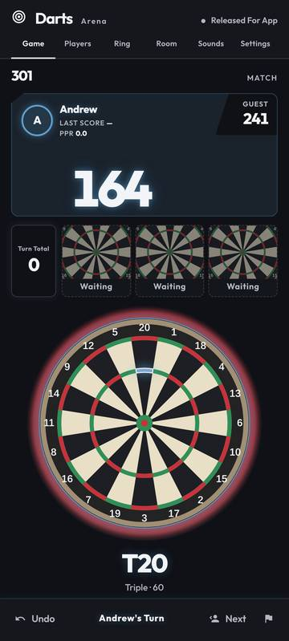
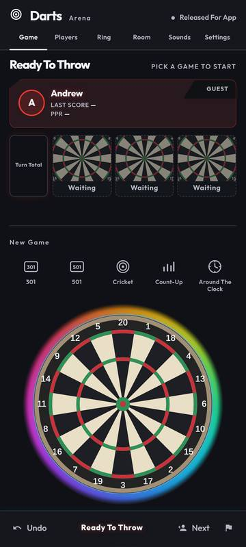
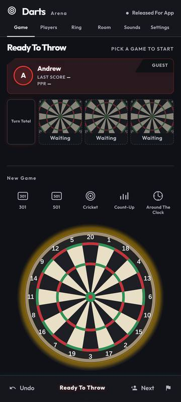

# Darts Arena Card

A single custom Lovelace card for the Granboard integration: live score, dartboard, New Game, undo / next / end game, LED ring controls, optional Room WLED lights, sound theme, and board settings. It is a native `custom:darts-arena-card` (one JavaScript module). It does **not** use button-card, card-mod, browser_mod, or any other custom Lovelace card.

This replaces earlier button-card dashboard templates.



## **Install These First**

Do these before you add the card. Items marked *optional* are only for that feature; skip them if you do not use it.

1. **Home Assistant 2025.1 or newer.**
2. **This Granboard integration**, installed from HACS (recommended) or copied manually, with your **Granboard 3 / 3s** added and connected. See the [main README](../README.md#installation) and the [Complete Setup Guide](../docs/INSTALL.md).
3. **Home Assistant Bluetooth** — a USB adapter or an ESPHome Bluetooth proxy (`active: true`). The integration needs this; the card will not see hits without it.
4. **This card file and a Lovelace resource** — follow [Install The Card](#install-the-card) below.

**Optional, only if you use that feature:**

- **WLED** (the Home Assistant WLED integration) — only for the card's **Room** tab lights. The example dashboard sets `wled: null` and hides those controls. Integration **WLED Sections** (lights around the board) are set up in **Granboard > Configure** and do not require this card option.
- **Alexa Media Player** — only if you play board sounds on an Amazon Echo. The card itself does not talk to Alexa.
- **InfluxDB / Grafana** — only for the optional stats dashboards in [docs/INFLUX-GRAFANA.md](../docs/INFLUX-GRAFANA.md). The card does not use them.
- **`input_text` / `input_boolean` helpers** — only as a fallback roster if you are not using Granboard player profiles (`granboard.add_player`, `sensor.<board>_players`).

**Not required for this card:** [button-card](https://github.com/custom-cards/button-card), [card-mod](https://github.com/thomasloven/lovelace-card-mod), browser_mod, config-template-card, or any other custom Lovelace card. Do not install those just to run Darts Arena.

**HACS** is recommended for installing and updating the Granboard *integration*. It is not required if you install the integration manually. The card JS is not auto-copied by HACS; you still copy it into `/config/www/granboard/` as below.

## Install The Card

1. Copy [`darts-arena-card.js`](darts-arena-card.js) from this folder to **`/config/www/granboard/darts-arena-card.js`** on your Home Assistant machine (create the `granboard` folder if needed).
2. Add a Lovelace resource (Settings > Dashboards > ⋮ > Resources, or in YAML):

   ```yaml
   url: /local/granboard/darts-arena-card.js?v=2c40de96
   type: module
   ```

   The `?v=2c40de96` query is a cache-buster (first eight characters of the file's sha256). After you replace the file, change that value or browsers and the companion app may keep the old module.
3. Create a **Panel** dashboard or view and add one card, `type: custom:darts-arena-card`. A full example is in [`darts-arena-card.yaml`](darts-arena-card.yaml). In the UI: Settings > Dashboards > Add Dashboard, then edit the view and set the view type to **Panel (single card)**.
4. Set **`prefix`** to the middle of your entity IDs (for example `granboard_5547` if you have `sensor.granboard_5547_game`). The card will not work until this matches your board.
5. Leave **`wled`** as `null` unless you want Room tab WLED controls. Do not set `newGameScript` unless you have your own wrapper; New Game calls `granboard.new_game`.

Reload the dashboard (or refresh the companion app, clearing the frontend cache if an old module is stuck).

## Card Options

| Option | Required | Notes |
|---|---|---|
| `prefix` | Yes | Entity prefix: `light.<prefix>_led_ring`, `sensor.<prefix>_game`, and the other Granboard entities. |
| `wled` | No | `null` (default in the example) hides Room WLED controls. Or one light object, or a list of lights, with optional `palette`, `preset`, `speed`, and `intensity` entity IDs (the card can also discover those by name). Requires the WLED integration for those entities. |
| `newGameScript` | No | Omit this so New Game uses `granboard.new_game`. Only set it if you have a custom `script.*` wrapper. |
| `helpers.players` | No | Fallback `input_text` for names if player profiles are not in use. |
| `helpers.colors` | No | Fallback `input_text` for colours. |
| `helpers.double` | No | Fallback `input_boolean` for Double Out. |

## Board Glow

The glow behind the dartboard **recreates** the LED ring's current effect, palette, colours, speed and intensity from Home Assistant **settings**. During a game it follows the current player and hit colours (the integration pauses the ambient ring effect while you play).

It is **not** a live per-LED readback. Home Assistant does not publish the individual ring LEDs, so Auto cannot show pixels that were changed only in the official Granboard app until Home Assistant has the new settings.





## Updating The Card

When a release includes a new `darts-arena-card.js`:

1. Replace `/config/www/granboard/darts-arena-card.js` with the new file.
2. Change the resource `?v=` value to the new file's sha256 prefix (first eight hex characters).
3. Refresh the dashboard / companion app (clear the frontend cache if it still shows the old card).
